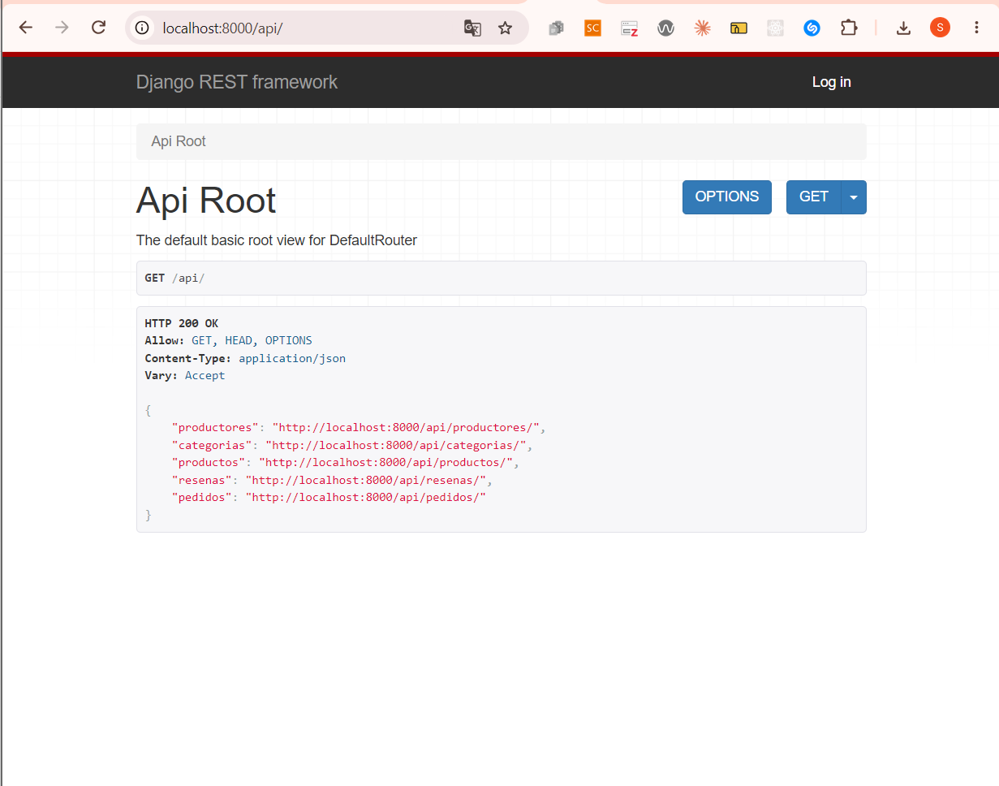
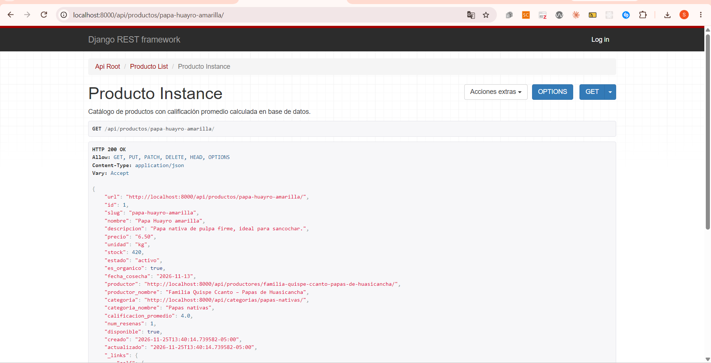
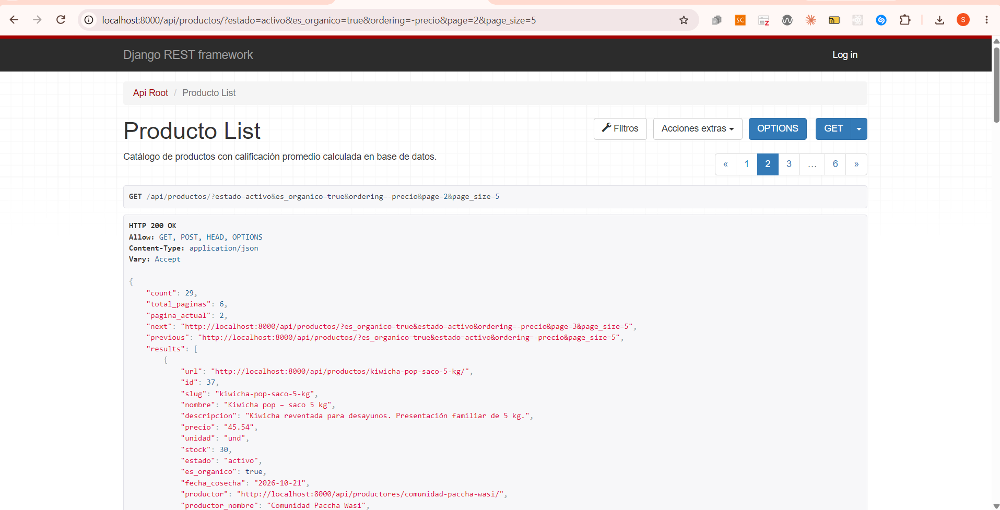
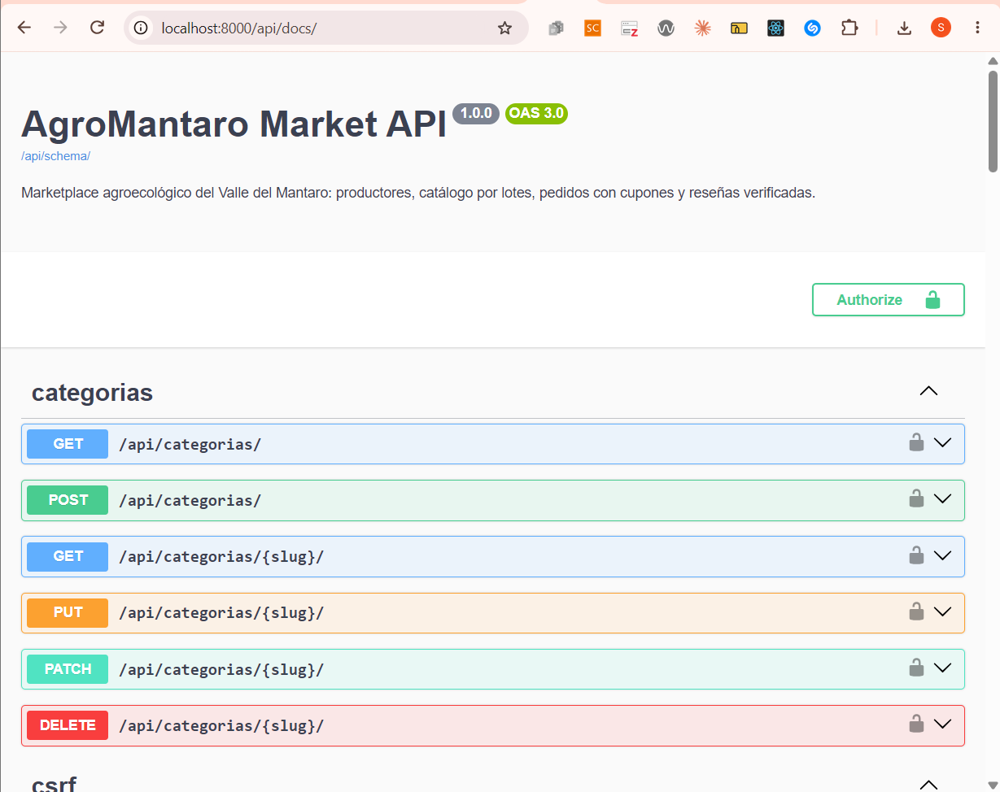
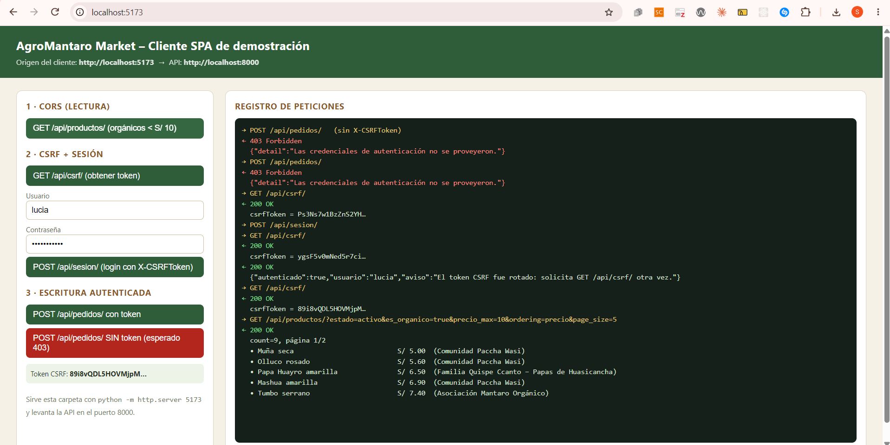
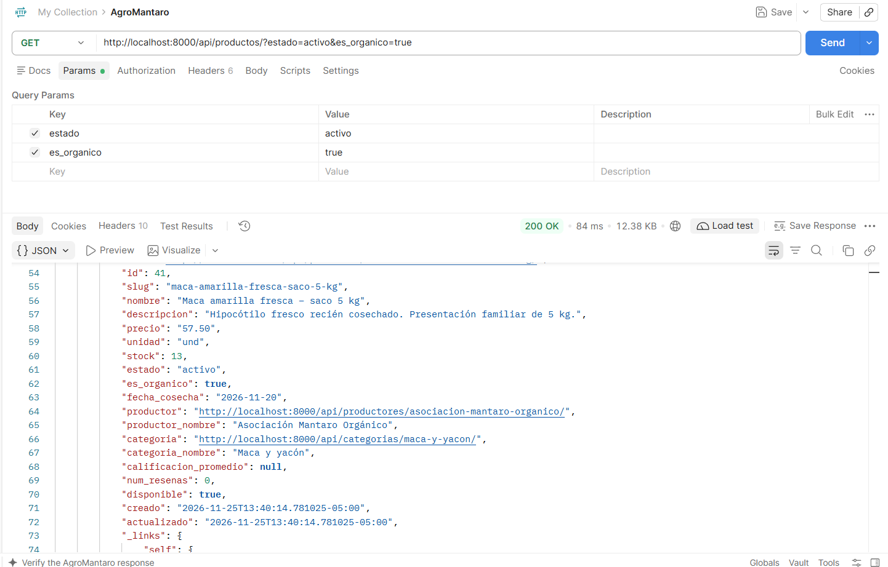
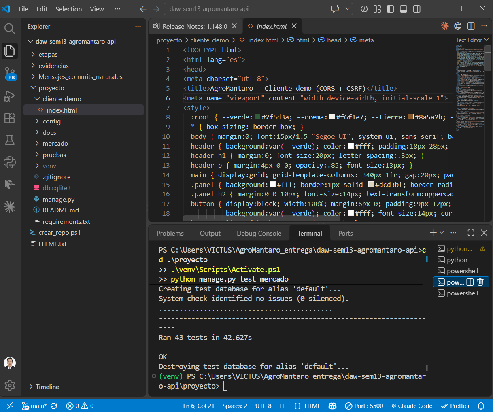

# AgroMantaro Market API

API RESTful (Django REST Framework) de un **marketplace agroecológico del Valle del Mantaro**:
productores certificados, catálogo por lotes con stock, pedidos con cupones y envío gratis,
y reseñas verificadas (solo quien recibió el producto puede opinar).

> Práctica de laboratorio – *Desarrollo de Aplicaciones Web (IS093A)* – Unidad II, Semana 12/13
> (DRF: serialización, ViewSets, routers, paginación, filtrado, throttling, CORS/CSRF, HATEOAS y OpenAPI).

## Puesta en marcha (Windows PowerShell)

```powershell
python -m venv venv
.\venv\Scripts\Activate.ps1          # si falla: Set-ExecutionPolicy -Scope Process Bypass
pip install -r requirements.txt
python manage.py migrate
python manage.py cargar_demo         # 43 productos andinos, cupones, pedidos y reseñas
python manage.py check
python manage.py runserver 8000
```

| URL | Descripción |
|---|---|
| `http://localhost:8000/api/` | Raíz navegable (HATEOAS) |
| `http://localhost:8000/api/docs/` | Swagger UI (OpenAPI 3) |
| `http://localhost:8000/api/redoc/` | Redoc |
| `http://localhost:8000/api/schema/` | Esquema OpenAPI (YAML/JSON) |

Usuarios de demostración (solo desarrollo): `admin / Admin12345!`, `lucia / Cliente123!`,
`marcos / Cliente123!`, `prod_quispe / Productor123!`, `prod_pangoa / Productor123!`.

## Recursos principales

| Recurso | Ruta | Métodos | Quién escribe |
|---|---|---|---|
| Productores | `/api/productores/` | CRUD | staff |
| Categorías (árbol) | `/api/categorias/` | CRUD | staff |
| Productos | `/api/productos/` | CRUD | productor dueño o staff |
| ↳ reseñas | `/api/productos/{slug}/resenas/` | GET, POST | cliente con pedido *entregado* |
| ↳ destacados | `/api/productos/destacados/` | GET | — |
| ↳ reponer stock | `/api/productos/{slug}/reponer-stock/` | POST | productor dueño o staff |
| Reseñas | `/api/resenas/` | GET, DELETE | autor o staff |
| Pedidos | `/api/pedidos/` | GET, POST | cliente autenticado (ve solo los suyos) |
| ↳ ciclo de vida | `/api/pedidos/{id}/pagar/`, `cancelar/`, `avanzar/` | POST | cliente / staff |
| ↳ cupón | `/api/pedidos/validar-cupon/` | POST | cliente |
| CSRF / sesión | `/api/csrf/`, `/api/sesion/` | GET / POST, DELETE | SPA |

### Reglas de negocio

* Un producto *activo* exige stock > 0; *agotado* exige stock = 0. Un productor solo publica bajo su propio perfil.
* `es_organico` solo para productores con certificación (SENASA, PGS o Comercio Justo).
* El servidor calcula `subtotal`, `descuento`, `costo_envio` (**gratis desde S/ 120** después del cupón; si no, S/ 12) y `total`.
* Crear un pedido descuenta stock de forma atómica (`select_for_update`); cancelar lo devuelve.
* Transiciones inválidas (pagar dos veces, cancelar un pedido entregado…) devuelven **409**.
* Los enlaces `_links` cambian con el estado: un pedido pagado ya no ofrece `pagar`; un producto agotado no ofrece `comprar`.

## Filtros, orden y paginación

```
GET /api/productos/?estado=activo&es_organico=true&precio_max=15&ordering=-creado&page=2&page_size=10
GET /api/productos/?categoria_arbol=granos-andinos&calificacion_min=4&search=quinua
GET /api/productos/?region=huancavelica&en_stock=true&ordering=precio
GET /api/pedidos/?estado=pagado&desde=2026-11-01&total_min=50
GET /api/productos/quinua-negra-collana/resenas/?limit=5&offset=5
```

## Throttling

| Ámbito | Límite |
|---|---|
| Anónimo | 20 / min |
| Autenticado | 120 / min |
| `pedidos` (crear, pagar, cancelar) | 10 / min |
| `resenas` (publicar) | 5 / min |

Al excederlo: `429 Too Many Requests` con cabecera `Retry-After`.

## CORS y CSRF (SPA en otro origen)

Orígenes permitidos en `CORS_ALLOWED_ORIGINS` (nunca `*`, porque se usan cookies). Flujo del cliente:

1. `GET /api/csrf/` → cookie `csrftoken` + token en JSON.
2. `POST /api/sesion/` con cabecera `X-CSRFToken`.
3. Volver a pedir `GET /api/csrf/` (el login **rota** el token).
4. Cualquier escritura autenticada envía `X-CSRFToken`; sin él, `403` en JSON.

Cliente de ejemplo: `cliente_demo/index.html` (`cd cliente_demo; python -m http.server 5173`).

## Pruebas

```powershell
python manage.py test mercado          # 43 pruebas
python manage.py spectacular --validate --fail-on-warn --file docs/schema.yml
.\pruebas\pruebas_api.ps1              # recorrido manual con Invoke-RestMethod
```

## Estructura

```
config/            settings.py (política REST/CORS/CSRF/OpenAPI global), urls.py
mercado/models.py  Productor, Categoria, Producto, Resena, Cupon, Pedido, ItemPedido
mercado/serializers.py   HyperlinkedModelSerializer + _links HATEOAS + validate()
mercado/permissions.py   permisos por rol (sin condiciones dentro de las vistas)
mercado/views.py         ViewSets delgados + @action
mercado/filters.py · pagination.py · seguridad.py
mercado/tests.py · test_seguridad_y_docs.py
docs/schema.yml    contrato OpenAPI generado (no se edita a mano)
```

## Trazabilidad con la guía (Semana 12/13)

| Paso | Qué se implementó | Dónde |
|---|---|---|
| 1 Setup | Paquetes, `INSTALLED_APPS`, `REST_FRAMEWORK`, CORS, `SPECTACULAR_SETTINGS`, `manage.py check` | `config/settings.py` |
| 2 Serialización | `HyperlinkedModelSerializer`, `SerializerMethodField`, `ReadOnlyField`, `validate()` anidado, `_links` | `mercado/serializers.py` |
| 3 ViewSets/Routers | `ModelViewSet`, `@action`, `DefaultRouter` | `mercado/views.py`, `mercado/urls.py` |
| 4 Filtrado/paginación/throttling | `DjangoFilterBackend`, `SearchFilter`, `OrderingFilter`, paginadores propios, Anon/User/Scoped | `filters.py`, `pagination.py`, `settings.py` |
| 5 CORS/CSRF/Docs | `django-cors-headers`, `X-CSRFToken`, `/api/docs/` | `seguridad.py`, `config/urls.py` |

Los usos de IA para resolver errores de CORS, CSRF y documentación están marcados en el código
con el formato `# IA: [problema] → Solución manual: [explicación técnica]`.

## Capturas

| API raíz | Recurso con enlaces HATEOAS |
|---|---|
|  |  |

| Filtros y paginación | Swagger UI |
|---|---|
|  |  |

| Cliente CORS/CSRF | Postman |
|---|---|
|  |  |

Pruebas automáticas: 43 tests en verde.


